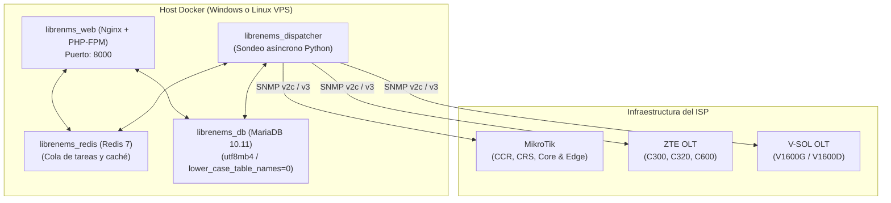

# LibreNMS ISP Monitoring Stack 📡

Plataforma de monitoreo y telemetría de red basada en **LibreNMS** sobre **Docker**, orientada específicamente a la infraestructura de telecomunicaciones y fibra óptica (FTTH/WISP) de un ISP, con soporte y autodescubrimiento para equipamiento **MikroTik**, **ZTE** y **V-SOL**.

---

## 📑 Tabla de Contenidos
1. [Propósito y Convivencia con Zabbix & Prometheus](#-propósito-y-convivencia-con-zabbix--prometheus)
2. [Arquitectura del Stack](#-arquitectura-del-stack)
3. [Despliegue en Windows (Docker Desktop)](#-despliegue-en-windows-docker-desktop)
4. [Despliegue en VPS / Servidor Linux (Producción)](#-despliegue-en-vps--servidor-linux-producción)
5. [Entendiendo la Pantalla de Validación (`validate.php`) en Docker](#-entendiendo-la-pantalla-de-validación-validatephp-en-docker)
6. [Configuración SNMP en Equipos de Red](#-configuración-snmp-en-equipos-de-red)
7. [Comandos Útiles de Mantenimiento](#-comandos-útiles-de-mantenimiento)
8. [Roadmap](#-roadmap)

---

## 🎯 Propósito y Convivencia con Zabbix & Prometheus

Este proyecto complementa una infraestructura de observabilidad existente que ya cuenta con **Zabbix** y **Prometheus + Grafana**:

* **Zabbix:** Monitoreo de sistemas y servidores de gestión (Radius, DNS, CRM/ERP de facturación, hypervisores y bases de datos).
* **Prometheus + Grafana:** Concentración de métricas de series temporales de alta resolución, contenedores y dashboards ejecutivos.
* **LibreNMS (este stack):** Monitoreo especializado de la capa física y de transporte de red:
  * Autodescubrimiento multi-fabricante sin diseñar plantillas MIB manuales.
  * Telemetría óptica **DOM/DDM** (niveles de potencia de transmisión y recepción Tx/Rx en dBm) para módulos SFP/SFP+ y puertos GPON.
  * Detección automática de sesiones **BGP**, vecinos **OSPF** y topología de red (**LLDP / MNDP**).
  * Facturación de enlaces por **percentil 95 (95th percentile)** para tránsitos y clientes corporativos.
  * Base lista para integración de respaldos automáticos de configuración con **Oxidized**.

---

## 🏗️ Arquitectura del Stack



### Componentes:
* **`librenms` (Web):** Interfaz gráfica de administración y visualización de telemetría.
* **`dispatcher`:** Servicio en segundo plano que actúa como **Master Poller y Scheduler** asíncrono en Python.
* **`db` (MariaDB 10.11):** Base de datos relacional optimizada para LibreNMS.
* **`redis`:** Bus de mensajería y caché para distribuir las cargas de trabajo de sondeo.

---

## 🪟 Despliegue en Windows (Docker Desktop)

### 1. Requisitos
* Windows 10/11 Pro, Enterprise o Home con WSL2 habilitado.
* [Docker Desktop](https://www.docker.com/products/docker-desktop/) instalado y en ejecución.
* Git instalado.

### 2. Pasos de Instalación
Abre **PowerShell** y ejecuta:

```powershell
# 1. Clonar el repositorio
git clone git@github.com:edgarprimera/monitor_librenems.git
cd monitor_librenems

# 2. Crear archivo de variables de entorno
Copy-Item .env.example .env

# 3. Editar las contraseñas en .env con tu editor preferido (Notepad, VS Code, etc.)
notepad .env

# 4. Levantar los contenedores
docker compose up -d

# 5. Crear el usuario administrador
docker compose exec librenms lnms user:add -r admin tu_usuario

# 6. Configurar la URL base
docker compose exec librenms lnms config:set base_url http://localhost:8000
```

Acceso: abre tu navegador en **`http://localhost:8000`**.

---

## 🐧 Despliegue en VPS / Servidor Linux (Producción)

Guía optimizada para **Ubuntu 22.04 / 24.04 LTS** o **Debian 12**.

### 1. Preparar el Servidor y Docker
Conéctate por SSH a tu VPS y ejecuta:

```bash
# Actualizar el sistema
sudo apt update && sudo apt upgrade -y

# Instalar dependencias previas
sudo apt install -y ca-certificates curl gnupg lsb-release git ufw

# Instalar Docker Engine oficial y Docker Compose Plugin
sudo install -m 0755 -d /etc/apt/keyrings
curl -fsSL https://download.docker.com/linux/ubuntu/gpg | sudo gpg --dearmor -o /etc/apt/keyrings/docker.gpg
sudo chmod a+r /etc/apt/keyrings/docker.gpg

echo \
  "deb [arch=$(dpkg --print-architecture) signed-by=/etc/apt/keyrings/docker.gpg] https://download.docker.com/linux/ubuntu \
  $(. /etc/os-release && echo "$VERSION_CODENAME") stable" | \
  sudo tee /etc/apt/sources.list.d/docker.list > /dev/null

sudo apt update
sudo apt install -y docker-ce docker-ce-cli containerd.io docker-buildx-plugin docker-compose-plugin

# Habilitar Docker para iniciar con el sistema
sudo systemctl enable --now docker
```

### 2. Configurar Firewall (UFW)
Asegura los puertos en tu VPS:

```bash
# Permitir SSH
sudo ufw allow 22/tcp

# Puerto web LibreNMS (o usa 80/443 si colocas proxy reverso Nginx)
sudo ufw allow 8000/tcp

# Opcional: recepción de SNMP Traps y Syslog desde los equipos de red
sudo ufw allow 162/udp
sudo ufw allow 514/udp

# Activar firewall
sudo ufw enable
```

### 3. Clonar y Levantar el Proyecto

```bash
# Clonar en /opt
sudo git clone git@github.com:edgarprimera/monitor_librenems.git /opt/monitor_librenems
cd /opt/monitor_librenems

# Crear y ajustar variables
sudo cp .env.example .env
sudo nano .env

# Levantar los servicios
sudo docker compose up -d

# Crear usuario administrador
sudo docker compose exec librenms lnms user:add -r admin tu_usuario

# Establecer la URL base de tu VPS (IP pública o dominio)
sudo docker compose exec librenms lnms config:set base_url http://IP_DE_TU_VPS:8000
```

> [!TIP]
> **Recomendación para Producción:** En un VPS público se aconseja instalar **Nginx** o **Caddy** como proxy reverso con certificado SSL gratuito (Let's Encrypt) para acceder vía `https://monitoreo.tu-isp.com`.

---

## 🔍 Entendiendo la Pantalla de Validación (`validate.php`) en Docker

Al ejecutar la validación desde la web (**Gear Icon $\rightarrow$ Validate Config**) o mediante CLI, LibreNMS evalúa el entorno. En una arquitectura de **microservicios / contenedores**, ciertas advertencias son completamente esperadas y normales:

| Validación | Estado | ¿Por qué ocurre en Docker? | Solución / Aclaración |
| :--- | :---: | :--- | :--- |
| **`WARN: You have no devices`** | ⚠️ Advertencia | Es una instalación limpia; aún no has agregado tu primer equipo. | Normal. Desaparece en cuanto agregas tu primer MikroTik, ZTE o V-SOL en `/addhost`. |
| **`FAIL: No python wrapper pollers found`** | ❌ Falso Positivo | El script evalúa el contenedor Web. El sondeo no corre en la Web, sino en el contenedor **`dispatcher`**. | **Comportamiento esperado en Docker**. El contenedor `dispatcher` corre de forma independiente en Python. |
| **`FAIL: Scheduler is not running`** | ❌ Falso Positivo | El contenedor Web no corre `cron` tradicional de Linux. | **Comportamiento esperado**. El contenedor `dispatcher` asume el rol de Master Scheduler y ejecuta las tareas programadas. |
| **`FAIL: Python3 module issue found`** | ❌ Falso Positivo | En Python 3.12+ la librería legacy `pkg_resources` fue deprecada, lo que genera un error al validar módulos de script. | No afecta en absoluto al funcionamiento del servicio. |
| **`WARN: Non-git Install`** | ⚠️ Informativo | El contenedor no se instaló clonando git en el host local. | Normal en Docker. Las actualizaciones se gestionan con `docker compose pull`. |
| **`WARN: base_url could be more specific`** | ⚠️ Corregido | Falta definir la URL exacta de acceso. | Ejecutar: `docker compose exec librenms lnms config:set base_url http://tu-ip:8000` |

---

## ⚙️ Configuración SNMP en Equipos de Red

### 1. MikroTik (RouterOS v6 / v7)
```routeros
# Habilitar el servicio SNMP
/snmp set enabled=yes contact="NOC ISP" location="Datacenter Principal"

# Crear comunidad SNMP de solo lectura para la IP del servidor LibreNMS
/snmp community add name=tuComunidadSNMP addresses=IP_DEL_SERVIDOR_LIBRENEMS/32 read-access=yes
```

### 2. ZTE OLT (C300 / C320 / C600)
```text
configure terminal
snmp-server community tuComunidadSNMP view AllView ro
snmp-server location "Pop Fibra Centro"
snmp-server contact "NOC ISP"
exit
write
```

### 3. V-SOL OLT (V1600 Series)
1. Ingresa a la interfaz web de la OLT: **Configuration $\rightarrow$ SNMP**.
2. Habilita el servicio SNMP.
3. En **Community**, ingresa tu clave de comunidad con permiso **Read-Only**.
4. En **Authorized Host / IP**, asigna la IP del servidor donde corre LibreNMS.

---

## 🛠️ Comandos Útiles de Mantenimiento

* **Ver el estado de los contenedores:**
  ```bash
  docker compose ps
  ```

* **Inspeccionar registros en tiempo real:**
  ```bash
  # Ver actividad del despachador de sondeo
  docker compose logs -f dispatcher

  # Ver actividad del servidor web
  docker compose logs -f librenms
  ```

* **Ejecutar validación por consola:**
  ```bash
  docker compose exec --user librenms librenms php validate.php
  ```

* **Forzar sondeo o descubrimiento manual de un dispositivo:**
  ```bash
  # Descubrimiento completo
  docker compose exec --user librenms librenms ./discovery.php -h IP_EQUIPO -d

  # Sondeo de métricas
  docker compose exec --user librenms librenms ./poller.php -h IP_EQUIPO -d
  ```

* **Actualizar el stack a la última versión:**
  ```bash
  docker compose pull
  docker compose up -d
  ```

---

## 🗺️ Roadmap

- [x] Despliegue de Docker Compose (MariaDB 10.11, Redis 7, Web y Dispatcher).
- [x] Documentación y compatibilidad para Windows y Linux VPS.
- [x] Módulo **Weathermap** integrado y persistente para diseño visual de mapas de enlaces NOC.
- [ ] Integración de **Oxidized** para respaldo automático y versionado de configuraciones de MikroTik y ZTE.
- [ ] Exportación de métricas de LibreNMS hacia **Grafana**.

---

## 🗺️ Editor de Mapas Weathermap (Estilo NOC)

El plugin **PHP Weathermap** está integrado y preconfigurado con persistencia de datos y ejecución periódica automática cada 5 minutos:

1. **Acceso al Menú:** En LibreNMS, dirígete a: **Overview $\rightarrow$ Plugins $\rightarrow$ Weathermap**.
2. **Editor Visual:** Para crear tu mapa y colocar los routers y OLTs de forma jerárquica con enlaces en tiempo real:
   👉 **`http://localhost:8000/plugins/Weathermap/editor.php`**
3. **Flujo de Creación:**
   * Crea un nuevo mapa (ejemplo: `mapa_red_isp.conf`).
   * **Add Node:** Agrega cada router (`RB_CORE_BRISAS`, `RB_CORE_PSI`, OLTs).
   * **Add Link:** Conecta los nodos entre sí y selecciona la interfaz física o túnel WireGuard de donde extraer el ancho de banda.
   * Guarda el mapa: el poller lo renderizará automáticamente cada 5 minutos mostrando el tráfico y los colores de saturación.

---

## 📄 Licencia

Distribuido bajo la licencia [MIT](LICENSE). LibreNMS está sujeto a la licencia GPLv3.
