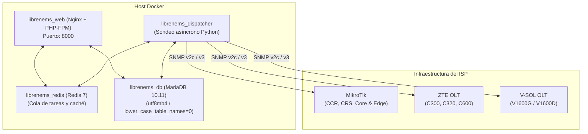

# LibreNMS ISP Monitoring Stack 📡

Plataforma de monitoreo y telemetría de red basada en **LibreNMS** sobre **Docker**, orientada específicamente a la infraestructura de telecomunicaciones y fibra óptica (FTTH/WISP) de un ISP, con soporte y autodescubrimiento para equipamiento **MikroTik**, **ZTE** y **V-SOL**.

---

## 🎯 Propósito y Convivencia con Zabbix & Prometheus

Este proyecto complementa una infraestructura de observabilidad ya existente que cuenta con **Zabbix** y **Prometheus + Grafana**:

* **Zabbix:** Monitoreo de servidores de gestión (Radius, DNS, CRM/ERP de facturación, hypervisores y bases de datos).
* **Prometheus + Grafana:** Concentración de métricas de alta resolución, series temporales de servidores y dashboards ejecutivos en tiempo real.
* **LibreNMS (este stack):** Monitoreo especializado de la capa física y de transporte de red:
  * Autodescubrimiento multi-fabricante sin necesidad de diseñar templates MIB manuales.
  * Telemetría óptica **DOM/DDM** (niveles de potencia de transmisión y recepción Tx/Rx en dBm) para puertos SFP/SFP+ y puertos GPON.
  * Detección automática de sesiones **BGP**, vecinos **OSPF** y topología de red (**LLDP / MNDP**).
  * Facturación de enlaces por **percentil 95 (95th percentile)**.
  * Base lista para integración de respaldos automáticos de configuración con **Oxidized**.

---

## 🏗️ Arquitectura del Stack Docker



### Componentes:
1. **`librenems` (Web):** Interfaz gráfica de administración y visualización de telemetría.
2. **`dispatcher`:** Demonio de sondeo (poller) asíncrono y de alto rendimiento que consulta los dispositivos de red vía SNMP sin bloquear el servidor web.
3. **`db` (MariaDB 10.11):** Base de datos relacional optimizada con los requerimientos específicos de LibreNMS.
4. **`redis`:** Bus de mensajería y caché para distribuir las cargas de trabajo de sondeo y descubrimiento.

---

## 🚀 Despliegue Rápido

### 1. Requisitos Previos
* [Docker Desktop](https://www.docker.com/) o Docker Engine con Docker Compose instalado.
* Conectividad IP (ruta o VPN) hacia los dispositivos de red que se van a monitorear.

### 2. Configuración de Variables de Entorno
Clona el repositorio y copia el archivo de ejemplo:

```bash
git clone git@github.com:edgarprimera/monitor_librenems.git
cd monitor_librenems
cp .env.example .env
```

Edita el archivo `.env` según tus necesidades:
* Define tu zona horaria en `TZ` (ej: `America/Caracas`, `America/Bogota`).
* Establece contraseñas seguras para `MYSQL_PASSWORD` y `MYSQL_ROOT_PASSWORD`.
* Si el puerto `8000` está ocupado, modifica `LIBRENEMS_WEB_PORT`.

### 3. Iniciar los Contenedores
Ejecuta:

```bash
docker compose up -d
```

Verifica el estado de los servicios:
```bash
docker compose ps
```

### 4. Crear el Usuario Administrador
Una vez que los contenedores estén en ejecución, crea el primer usuario administrador desde la consola:

```bash
docker compose exec librenems lnms user:add -r admin tu_usuario
```
*(El sistema te solicitará contraseña y correo electrónico).*

### 5. Acceder a la Interfaz Web
Abre tu navegador e ingresa a:
👉 **`http://localhost:8000`** *(o la IP de tu servidor en el puerto configurado)*.

---

## ⚙️ Configuración SNMP en Equipos de Red

Para que LibreNMS pueda descubrir automáticamente tus equipos, configura SNMP en cada plataforma:

### 1. MikroTik (RouterOS v6 / v7)
```routeros
# Habilitar SNMP
/snmp set enabled=yes contact="NOC ISP" location="Datacenter Principal"

# Crear comunidad SNMP de solo lectura
/snmp community add name=tuComunidadSNMP addresses=IP_DEL_SERVIDOR_LIBRENEMS/32 read-access=yes
```

### 2. ZTE OLT (C300 / C320 / C600)
```text
# En modo configuración global
configure terminal
snmp-server community tuComunidadSNMP view AllView ro
snmp-server location "Pop Fibra Centro"
snmp-server contact "NOC ISP"
```

### 3. V-SOL OLT (V1600 Series)
* Desde la interfaz Web de V-SOL: **Configuration** $\rightarrow$ **SNMP**.
* Habilitar el servicio SNMP.
* Definir **Community String** (solo lectura / Read-Only).
* Permitir la IP del servidor LibreNMS como Host autorizado.

---

## 🛠️ Comandos Útiles de Mantenimiento

* **Ver registros en tiempo real:**
  ```bash
  docker compose logs -f librenems
  docker compose logs -f dispatcher
  ```

* **Ejecutar validación de instalación de LibreNMS:**
  ```bash
  docker compose exec --user librenems librenems php validate.php
  ```

* **Descubrir o sondear manualmente un dispositivo:**
  ```bash
  # Forzar descubrimiento completo de un equipo por IP
  docker compose exec --user librenems librenems ./discovery.php -h IP_EQUIPO -d

  # Forzar sondeo de métricas de un equipo por IP
  docker compose exec --user librenems librenems ./poller.php -h IP_EQUIPO -d
  ```

* **Reiniciar el stack:**
  ```bash
  docker compose restart
  ```

* **Detener el stack conservando los datos:**
  ```bash
  docker compose down
  ```

---

## 🗺️ Roadmap de Mejoras Recomendadas

1. **Oxidized:** Integrar contenedor de Oxidized para respaldo automático versionado en Git de las configuraciones de MikroTik y ZTE.
2. **Weathermap:** Activar el plugin de mapa de tráfico en tiempo real para pantallas de NOC.
3. **Grafana Data Source:** Conectar LibreNMS con Grafana para reutilizar las métricas ópticas en tableros consolidados junto a Prometheus.

---

## 📄 Licencia

Este proyecto y su configuración se distribuyen bajo la licencia [MIT](LICENSE).
LibreNMS se distribuye bajo la licencia GNU General Public License v3.0 (GPLv3).
